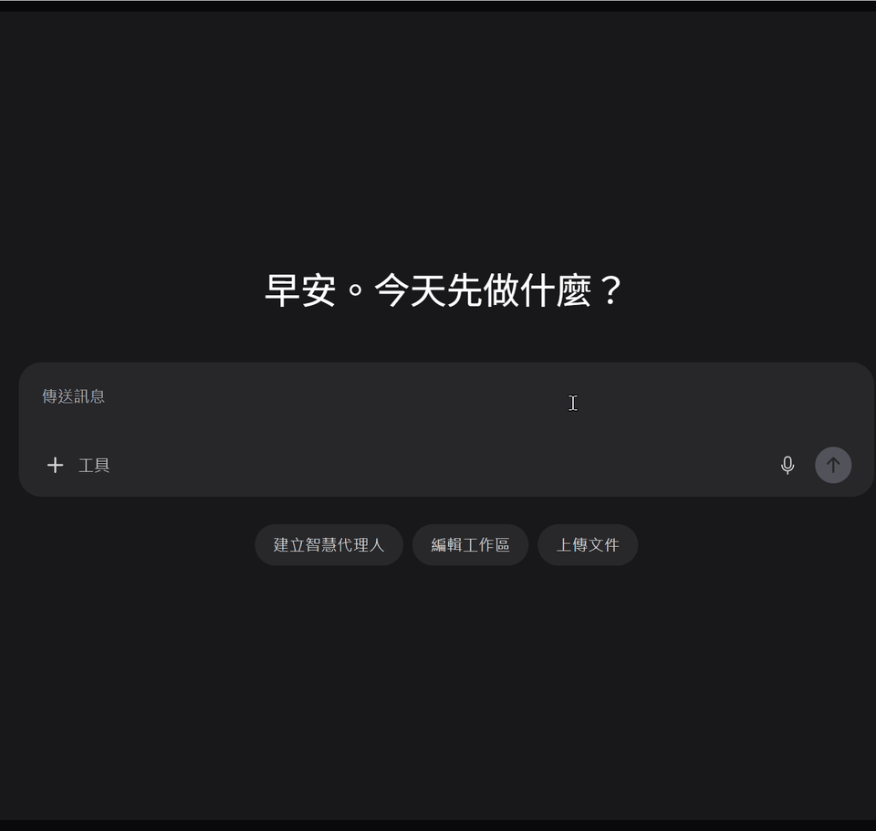
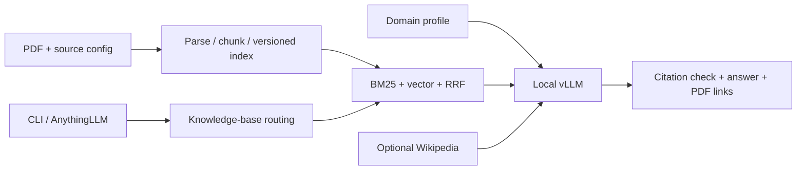

# iPAS Learning Hub — local RAG with traceable PDF citations

English | [繁體中文](README.zh-TW.md)

A local RAG pipeline that retrieves evidence from PDFs, checks citation IDs against the retrieved evidence, and links PDF citations to the source page. The bundled example uses Taiwan's **iPAS AI Application Planner** certification materials. You can use your own text-based PDFs by changing the source configuration and domain profile.

> [docs/EVIDENCE.md](docs/EVIDENCE.md) maps project claims to code and tests.
>
> **Language note:** this README is in English. The detailed documents under [docs/](docs/README.md) (setup, architecture, evaluation, evidence) are in Traditional Chinese, as are the prompts, answers and program messages, because the source material is Chinese. Code identifiers, `.env.example` and CI are in English.

## What it looks like



Local vLLM (Qwen3-VL-8B) + an index of the five iPAS study guides + the iPAS profile, asked in AnythingLLM "What is the difference between differential privacy and homomorphic encryption?" (in Chinese). Each sentence is tagged [教材N] ("course material N"), and clicking a citation opens page 172 of the official study guide PDF. The wait for generation is sped up 4×; actual generation took about 16 seconds. The guide pages appear only to demonstrate citation linking; the guides themselves are not in this repo.

## Why

These problems keep coming up when you use an LLM to study course material:

| Common problem | What this project does |
|---|---|
| The model cites a source that does not exist | A citation ID must belong to a chunk actually retrieved for this question; the model gets one repair attempt, and if it still fails the answer is refused rather than shown as grounded |
| A citation is attached, but it does not match the sentence | A second local-model pass checks, sentence by sentence, whether the cited chunk actually states the sentence and flags ⚠ when it does not (on synthetic mismatched citations it caught 67%, vs. 54% for the lexical check); a lexical check of numbers and terms runs as well. Both are labelled as checks, not fact-checking |
| The model answers despite having little evidence | An empty evidence set returns an insufficient-evidence response without calling the model. Dense retrieval can still return weak candidates, and supported answers can retain uncited sentences with a warning. See [the refusal trial](docs/evaluation.md#凍結測試集的回答層試跑2026-11-19). |
| After a revision or erratum, nobody knows which version an answer used | The PDF's SHA-256, errata and embedding revision are recorded; index IDs are content hashes, and a tampered index is refused at load time |
| Every new domain means rewriting prompts and code | Shared evidence rules are fixed; the assistant role and domain rules live in a profile file |
| "A vector database must be more accurate" | BM25 stays as the baseline and vector results are fused with RRF. On 243 exam questions, including three pipeline trial questions, hybrid scored 5.3 percentage points higher than BM25. Excluding the three trial questions gives a 5.4-point difference. The vector-only comparison has a confidence interval that includes zero. |

## Quick start

Install the locked dependencies using Python 3.11+ and [uv](https://docs.astral.sh/uv/). Installation may download dependencies. Once installed, the demo runs offline on CPU with bundled notes and a scripted model.

```sh
uv sync --locked
uv run --no-sync python -m ipas_hub.demo
```

The demo uses iPAS topic notes written by the author (not the official material), the iPAS profile, and a stand-in model that replies from a script. Everything else is the real code: index integrity check, BM25 retrieval, citation check and repair, lexical check, and output formatting. Below is the actual output of the multiple-choice scenario (the output is in Chinese; the question asks which option is a typical supervised-learning task: (A) clustering, (B) dimensionality reduction, (C) classification, (D) association rule mining):

```text
━━ grounded-answer ━━ 選擇題逐項說明並引用檢索到的頁面，最後給出答案
問題：下列何者屬於監督式學習的常見任務？(A) 分群 (B) 降維 (C) 分類 (D) 關聯規則探勘
檢索（BM25，前 3）：
  #1 notes:1-1:0　監督式學習：訓練資料附有標籤（正確答案），模型學習從…
  #2 notes:3-1:0　過擬合：模型在訓練資料上表現很好，在新資料上表現變差…
模型呼叫：1 次（腳本化替身）

狀態：有依據（只用教材）

(A) 分群是非監督式學習的常見任務。 [教材1]
(B) 降維也是非監督式學習的常見任務。 [教材1]
(C) 分類使用附有標籤的資料，屬於監督式學習。 [教材1]
(D) 關聯規則探勘不需要標籤，片段未提及，此為推論。
  ⚠ 此句沒有引用，未經核對
答案：C

依據：
- [教材1] 教材 iPAS 主題自寫筆記（示範用） 1-1
```

| Scenario | What happens | Result |
|---|---|---|
| `grounded-answer` | A multiple-choice answer cites a retrieved page and flags an uncited inference | Grounded, ending with "答案：C" (Answer: C) |
| `repaired-citation` | The first reply cites a chunk that does not exist | Passes after one repair; the repair count is recorded |
| `fabricated-citation` | The reply still fabricates a citation after repair | Refused; not shown as a grounded answer |
| `mis-cited-sentence` | The citation exists, but a term in the sentence is not in the chunk | Answer kept, sentence flagged with ⚠ |
| `out-of-scope` | The notes contain nothing relevant | Model not called; insufficient evidence reported |
| `tampered-index` | An index chunk has been modified | Hash mismatch; index refused |

The demo prints six scenarios, including a repaired citation, a refusal, and a rejected index. To try BM25 on your own PDF, follow [Using your own data](docs/custom-data.md). To run hybrid retrieval and a local LLM with the iPAS materials, follow [Full Windows setup](docs/setup.md).

## Architecture



The file index can be used on its own or loaded into PostgreSQL + pgvector: the database handles vector distance queries, while BM25 and fusion run in Python. AnythingLLM is only the chat UI; no documents are uploaded to it. With Docker Compose, `--profile serve` starts the database, vLLM and the RAG endpoint together (see the [setup guide](docs/setup.md), Chinese). Module locations, data flow and design trade-offs are in the [architecture doc](docs/architecture.md) (Chinese).

**Project-specific engineering (developed with AI assistance):** document parsing and errata, the versioned index, retrieval fusion, citation checking, domain profiles, the OpenAI-compatible endpoint and knowledge-base routing. The chat UI (AnythingLLM), model server (vLLM), embedding model (BGE-M3) and generation model (Qwen3) are third-party work.

The [technical documentation index](docs/README.md) links to implementation details, chunking and embedding experiments, answer evaluation, and AI collaboration cases.

## The example and your own data

| Goal | Requires | Doc (Chinese) |
|---|---|---|
| See which files make up the iPAS example and how to run it | — | [examples/ipas](examples/ipas/README.md) |
| Set up all five iPAS subjects + hybrid retrieval + chat UI | NVIDIA GPU, Docker | [Full Windows setup](docs/setup.md); environment variables in [.env.example](.env.example) |
| Use your own PDFs and domain settings | Retrieval needs only a CPU | [Using your own data](docs/custom-data.md) |

Switching data means changing only three things: the **source config** (paths, versions, SHA-256, optional download URLs), the **profile** (assistant role, document names, domain rules), and optionally the **routing** (which knowledge base each chat-UI model name maps to).

The author's setup: Ryzen 7 9800X3D, 32 GiB RAM, RTX 5070 Ti 16 GB, Windows 11 + Docker Desktop; the BAAI/bge-m3 embedding model runs on CPU and Qwen3-VL-8B-Instruct-FP8 runs on the GPU through vLLM. This is **not** a minimum requirement; see [runtime environment](docs/environment.md).

## Course material, models and external content

| Material | What is in the repo | How to get it |
|---|---|---|
| iPAS study guides | Only the official URLs and SHA-256 hashes | `cli fetch` downloads them from the official site and verifies the hash; PDFs, chunk text and indexes are never committed |
| Example notes | Full text, written by the author | Shipped with the repo under MIT, like the code |
| Embedding and generation models | Only model names and pinned revisions | Download them yourself from Hugging Face; no weights are included |
| Wikipedia supplements | Nothing | Queried at run time; citations show CC BY-SA 4.0, a link to the article revision, and a note that the model paraphrased it |

Licenses and sources for each item are in [THIRD_PARTY_NOTICES](THIRD_PARTY_NOTICES.md).

## Evaluation and limitations

The evaluation scored answers against the official key for 243 iPAS questions from five papers. Three questions were also used in a pipeline trial that led to a citation ID repair change.

| Retrieval | Accuracy | Insufficient evidence (refused) | Retrieval p50 | End-to-end generation p50 |
|---|---|---|---|---|
| BM25 | 81.9% | 37 | 21 ms | 6.8 s |
| Vector | 84.0% | 24 | 245 ms | 7.1 s |
| Hybrid (default) | **87.2%** | 22 | 242 ms | 7.1 s |

Hybrid is 5.3 percentage points above BM25, with a paired per-question bootstrap 95% confidence interval of +1.7 to +9.0; the interval for vector vs. BM25 includes 0. A question-parsing bug was found afterwards (5 questions had been merged into the previous one, and question-group context was attached to the wrong question); after fixing it and rerunning the 23 affected questions, the total is 248 questions: hybrid 87.9%, vector 83.5%, BM25 82.3%, with hybrid 5.6 points above BM25 (+2.4 to +9.7). This compares chosen options only. Separately, 20 questions were randomly sampled from those hybrid answered correctly and reviewed by hand: the reasoning was correct in 20, and the citations fully supported the answer in 18 and partially in 2 (they cited a page on a related topic that did not directly state the sentence). The sample is small, it was reviewed by the author, and it uses a single model and a single run. Questions, criteria, failure analysis and how to rerun are in the [evaluation doc](docs/evaluation.md#保留題評估2026-11-18) (Chinese).

This is a working local prototype for PDFs with extractable text. Chat handles one turn at a time and sends SSE after generation finishes. Knowledge-base routing selects the documents to search. Multi-user access controls, answer quality on new documents, and complete installation on a clean machine are outside current verification. See the [evaluation and limitations](docs/evaluation.md) (Chinese).

## Design principles

- **Traceability:** record the document version and PDF page for each PDF citation.
- **Empty evidence:** report insufficient evidence before generation when the evidence set is empty.
- **Checks are enforced by code:** citation validity is verified by the program, not by a "please cite your sources" line in the prompt.
- **A domain is configuration, not code:** evidence rules are shared across domains; domain differences live only in the profile.
- **Baseline first, then improvements:** BM25 is the control; hybrid retrieval has to prove with data that its extra latency is worth it.
- **Be honest about what a check covers:** a lexical check is called a lexical check, not fact-checking.
- **Don't redistribute other people's content:** course material is recorded only as URLs and hashes, model weights are not bundled, and external content is labeled with its license.

## Repository layout

```text
src/ipas_hub/       Generic pipeline: retrieval, RAG, profiles, fetch, CLI, chat server and offline demo
examples/ipas/      iPAS example: source config, profile, author-written demo notes, eval sets
config/             Knowledge-base routing for the chat endpoint
tests/              Unit tests on synthetic data, HTTP routing tests, optional pgvector integration tests
docs/               Architecture, environment, setup, custom data, evaluation, evidence map and status (Chinese)
docs/internal/      Development history, past validation and AI-collaboration records (not required reading, Chinese)
```

## Verification and data safety

- `uv run pytest` runs all tests; tests that need a database are skipped when `PG_TEST_DSN` is not set.
- GitHub Actions runs on every PR: `ruff check` and `ruff format --check`, pgvector integration tests, the offline demo, a check that `data/` is not tracked, in-container tests, and building and smoke-starting the runtime image.
- Tests use only synthetic data and stand-in models: they prove pipeline behavior, not answer quality.
- What must never be committed, and where runtime data goes, is described in [SECURITY.md](SECURITY.md) (Chinese).

## License

The code and the author's own content in this repo (including the example notes and documentation) are under [MIT](LICENSE). MIT does not cover third-party content: course material, models and Wikipedia content each follow their own terms; see "Course material, models and external content" above and [THIRD_PARTY_NOTICES](THIRD_PARTY_NOTICES.md).

This is an independent learning project and does not represent the official position of the iPAS organizers or any third-party tool.
