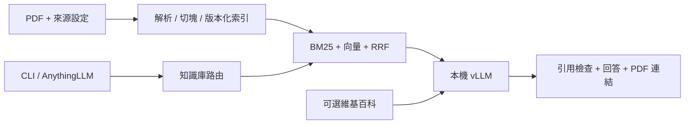

# iPAS Learning Hub

**可回查 PDF 來源的本機 RAG 知識助理。**

從 iPAS AI 應用規劃師備考出發，將「找教材 → 比對證據 → 回答 → 開啟原頁」串成一個流程。使用 BM25 與向量混合檢索、本機 LLM 和逐句引用，並以勞動基準法獨立知識庫示範延伸到非 iPAS 的文字型 PDF。

[架構與設計](docs/architecture.md) · [實際執行環境](docs/environment.md) · [快速開始](docs/documents.md) · [評估結果](docs/evaluation.md) · [開源工具與授權](THIRD_PARTY_NOTICES.md)

## 專案重點

- **文件可追溯**：保存來源版本、SHA-256、PDF 頁碼、勘誤與 embedding revision，可指定舊索引回查。
- **混合檢索**：提供 BM25 基線、向量搜尋與 RRF 融合，支援檔案索引及 PostgreSQL＋pgvector。
- **依據導向回答**：本機模型依片段生成逐句引用，檢查引用 ID、提示字詞落差，依據不足時明確回報。
- **知識庫分離**：明確指定庫與版本，或以 model 路由到不同庫及外搜政策；避免 iPAS 與其他文件混查。
- **可替換文件**：iPAS 專用解析與一般 PDF 解析共用後續管線；一般 PDF 以實際頁序引用。

主要實作在文件處理、版本化索引、檢索融合、引用檢查及服務路由。聊天 UI 使用 AnythingLLM，模型服務使用 vLLM，均為第三方成果。

## 架構



檔案索引可獨立使用，或載入 PostgreSQL＋pgvector。BM25 與融合在 Python 執行，資料庫負責向量距離查詢；AnythingLLM 只提供聊天介面，不需上傳文件。模組位置、資料流與設計取捨見 [架構文件](docs/architecture.md)。

## 實際執行環境

作者的開發／自用配置，於 2026-11-17 查核；**不是最低需求**。

| 項目 | 配置 |
|---|---|
| CPU／RAM | AMD Ryzen 7 9800X3D，8 核心／16 執行緒；32 GiB RAM |
| GPU | NVIDIA GeForce RTX 5070 Ti，16 GB VRAM |
| 系統 | Windows 11 專業版＋Docker Desktop Linux containers |
| 嵌入模型 | BAAI/bge-m3，CPU 執行、1,024 維 |
| 生成模型 | Qwen3-VL-8B-Instruct-FP8，vLLM／GPU，僅載入文字部分 |

驅動、Python／Docker 版本與模型參數見 [環境文件](docs/environment.md)。只做 PDF＋BM25 檢索不需要 GPU、資料庫或生成模型。

## 開始使用

在 repo 根目錄執行（Python ≥3.11，使用 uv）：

```powershell
uv sync --locked
uv run python -m ipas_hub.cli --help
uv run pytest -p no:cacheprovider
```

這會安裝基本依賴並執行測試；完整聊天另需模型及服務。套件由 [pyproject.toml](pyproject.toml) 與 [uv.lock](uv.lock) 管理。

| 使用方式 | 操作文件 |
|---|---|
| 用自己的 PDF，先在 CPU 上檢索 | [一般 PDF 快速開始](docs/documents.md) |
| 安裝五科 iPAS＋混合檢索＋聊天 UI | [Windows 完整安裝](docs/setup.md) |
| 看非 iPAS 文件與多工作區範例 | [勞基法案例](docs/examples/labor-law.md) |

教材、模型與索引不附在 repo 中。iPAS 沒有本機勘誤替換檔時使用 `config/knowledge-base.no-errata.json`，回答依據仍可能包含更正前文字。

## 評估與目前限制

已有單元測試、HTTP／分庫測試、可選 PostgreSQL 整合測試與 Docker CI。歷史小樣本比較顯示混合檢索值得持續評估，但尚不足以宣稱穩定勝過 BM25；頁碼命中與測試通過也不等於回答正確。結果、分母、版本與測法見 [評估證據](docs/evaluation.md)。

目前定位為可自用與展示的本機原型。僅支援可擷取文字的 PDF，沒有 OCR、Word 或圖表理解；生成 prompt 仍有 iPAS 身份設定。聊天採單輪問題，SSE 於完整生成後傳送；分庫不等同多人權限隔離。後續重點是通用 prompt、可分享示範與保留測試集、乾淨新機重現。

## 開源工具與資料授權

使用 Python、NumPy、pypdf、Sentence Transformers、Psycopg、PostgreSQL／pgvector、vLLM、AnythingLLM、uv、Docker Compose 與 pytest。完整用途、模型授權、官方來源及尚待查核項目見 [THIRD_PARTY_NOTICES](THIRD_PARTY_NOTICES.md)。

這是獨立學習專案，不代表 iPAS 主辦單位或第三方工具官方背書。程式 LICENSE 尚未選定；教材、模型、維基內容與程式各有不同權利條件，公開準備尚未完成。內部文件建議使用本機模型與 `--web none`；`data/runs/` 會保存問題及證據片段。

<details>
<summary>專案結構與維護紀錄</summary>

```text
src/ipas_hub/       RAG、CLI 與聊天服務
tests/             自動化測試
config/            文件來源與知識庫路由
docs/              架構、環境、安裝、評估與案例
docs/internal/     開發歷史、驗證證據及協作範本
```

[所有文件](docs/README.md) · [維護紀錄](docs/internal/README.md) · [AI 協作入口](AGENTS.md)

</details>
