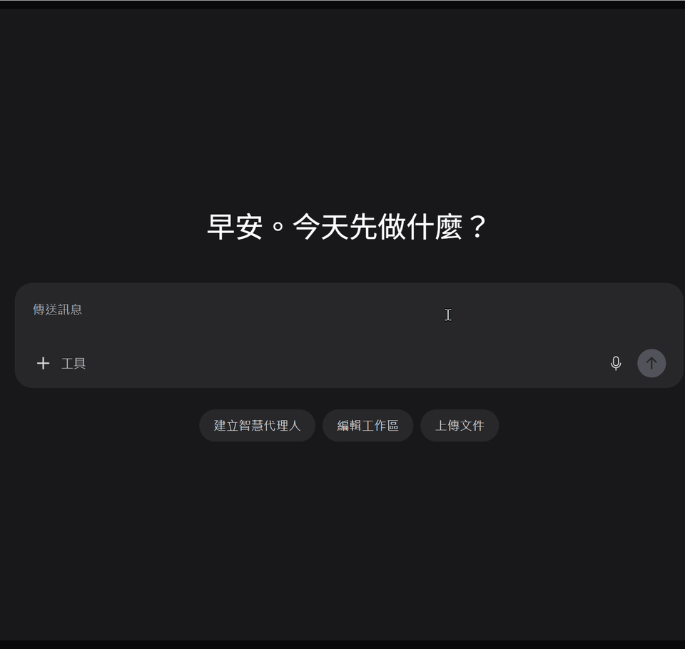
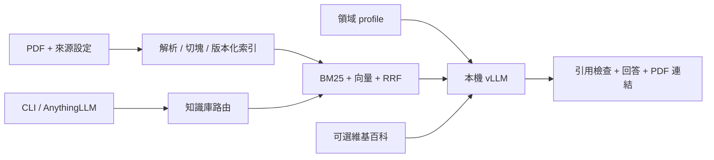

# iPAS Learning Hub — 引用可回查 PDF 原頁的本機 RAG

[English](README.md) | 繁體中文

一套在本機執行的 RAG 管線，從 PDF 檢索證據，核對模型引用的片段 ID，並讓 PDF 引用連回原頁。repo 附帶 **iPAS AI 應用規劃師**教材範例。要使用自己的文字型 PDF，可調整來源設定與領域 profile。

> [docs/EVIDENCE.md](docs/EVIDENCE.md) 將專案主張對應到程式和測試。

## 實際畫面



本機 vLLM（Qwen3-VL-8B）＋五科 iPAS 索引＋iPAS profile，在 AnythingLLM 提問「請問差分隱私跟同態加密的差異」：回答逐句標示 [教材N]，點引用直接開到官方學習指引的 PDF 第 172 頁。等待生成的片段已快轉 4 倍，實際生成約需 16 秒。畫面中的教材頁面只用來示範引用跳頁，教材本身不在 repo 內。

## 為什麼做這個

拿 LLM 查教材時，以下問題會反覆出現：

| 常見問題 | 這個專案的做法 |
|---|---|
| 模型引用了不存在的來源 | 引用 ID 必須屬於本次實際檢索到的片段；退回修正一次，仍錯就拒絕顯示為有依據的回答 |
| 有附引用，內容卻對不上 | 回答後再請本機模型逐句核對引用片段是否直接寫出該句，沒有就標 ⚠（合成的錯誤引用抓出 67%，字詞核對 54%）；另保留數字與術語的字詞核對。兩者都明寫是核對，不是事實查核 |
| 證據很弱時，模型仍可能作答 | 證據清單為空時直接回報依據不足。向量分支仍可能取回相關性弱的候選。有依據的回答若包含未引用句，會保留該句並提示警告。見[拒答試跑](docs/evaluation.md#凍結測試集的回答層試跑2026-11-19)。 |
| 教材改版或勘誤後，不知道答案依據哪一版 | 記錄 PDF 的 SHA-256、勘誤、embedding revision；索引 ID 是內容雜湊，被改過就拒絕載入 |
| 換一個領域就要改 prompt 和程式 | 共用的證據規則固定，助理角色與領域規則放在 profile 設定檔 |
| 「用了向量資料庫應該比較準」 | 保留 BM25 基線，以 RRF 融合向量結果。243 題試題（含 3 題管線試跑）中，混合比 BM25 高 5.3 個百分點，排除試跑題後差 5.4 個百分點。純向量相對 BM25 的差異區間含 0。 |

## 快速開始

使用 Python 3.11+ 和 [uv](https://docs.astral.sh/uv/) 安裝鎖定版本的依賴，首次安裝可能需要下載。安裝後，示範可在 CPU 上離線執行，使用內附筆記與腳本化模型。

```sh
uv sync --locked
uv run --no-sync python -m ipas_hub.demo
```

示範使用作者自寫的 iPAS 主題筆記（不是官方教材）、iPAS 的 profile，以及「照腳本回覆的替身模型」；其餘都是正式程式：索引完整性檢查、BM25 檢索、引用檢查與修正、字詞核對、輸出格式。以下是選擇題情境的實際輸出：

```text
━━ grounded-answer ━━ 選擇題逐項說明並引用檢索到的頁面，最後給出答案
問題：下列何者屬於監督式學習的常見任務？(A) 分群 (B) 降維 (C) 分類 (D) 關聯規則探勘
檢索（BM25，前 3）：
  #1 notes:1-1:0　監督式學習：訓練資料附有標籤（正確答案），模型學習從…
  #2 notes:3-1:0　過擬合：模型在訓練資料上表現很好，在新資料上表現變差…
模型呼叫：1 次（腳本化替身）

狀態：有依據（只用教材）

(A) 分群是非監督式學習的常見任務。 [教材1]
(B) 降維也是非監督式學習的常見任務。 [教材1]
(C) 分類使用附有標籤的資料，屬於監督式學習。 [教材1]
(D) 關聯規則探勘不需要標籤，片段未提及，此為推論。
  ⚠ 此句沒有引用，未經核對
答案：C

依據：
- [教材1] 教材 iPAS 主題自寫筆記（示範用） 1-1
```

| 情境 | 發生什麼事 | 結果 |
|---|---|---|
| `grounded-answer` | 選擇題引用實際檢索到的頁面，未引用的推論會標警告 | 有依據，最後給出「答案：C」 |
| `repaired-citation` | 第一次引用不存在的片段 | 退回修正一次後通過，並記錄修正次數 |
| `fabricated-citation` | 修正後仍捏造引用 | 拒絕顯示為有依據的回答 |
| `mis-cited-sentence` | 引用存在，但句中術語不在片段裡 | 保留回答，句子標 ⚠ |
| `out-of-scope` | 筆記裡沒有相關內容 | 不呼叫模型，回報依據不足 |
| `tampered-index` | 索引片段被改過 | 雜湊不符，拒絕載入 |

示範會列出六種情境，包括引用修正、拒答與索引竄改。要用自己的 PDF 試 BM25，直接看[換成自己的資料](docs/custom-data.md)。要用 iPAS 教材啟動混合檢索和本機聊天，從 [Windows 完整安裝](docs/setup.md) 開始。

## 架構



檔案索引可以單獨使用，也可以載入 PostgreSQL＋pgvector：資料庫負責向量距離查詢，BM25 與融合在 Python 執行。AnythingLLM 只當聊天介面，不需要上傳文件。用 Docker Compose 時，`--profile serve` 會一起啟動資料庫、vLLM 與 RAG 端點（見[操作手冊](docs/setup.md)）。模組位置、資料流與設計取捨見 [架構文件](docs/architecture.md)。

**本專案開發的部分（由 AI 協助開發）**：文件解析與勘誤、版本化索引、檢索融合、引用檢查、領域 profile、OpenAI 相容端點與知識庫路由。聊天 UI（AnythingLLM）、模型服務（vLLM）、嵌入模型（BGE-M3）與生成模型（Qwen3）都是第三方成果。

從[技術文件導覽](docs/README.md)可找到實作細節、切塊與 embedding 實驗、回答評估，以及 AI 協作案例。

## 範例與自己的資料

| 想做什麼 | 需要 | 文件 |
|---|---|---|
| 看 iPAS 範例由哪些檔案組成、怎麼跑 | — | [examples/ipas](examples/ipas/README.md) |
| 架設五科 iPAS＋混合檢索＋聊天 UI | NVIDIA GPU、Docker | [Windows 完整安裝](docs/setup.md)；環境變數見 [.env.example](.env.example) |
| 換成自己的 PDF 與領域設定 | 檢索只需 CPU | [換成自己的資料](docs/custom-data.md) |

換資料要改的只有三樣：**來源設定**（路徑、版本、SHA-256、可選的下載網址）、**profile**（助理角色、文件名稱、領域規則），以及可選的**路由**（聊天介面的 model 名稱對應哪個庫）。

作者的實際配置：Ryzen 7 9800X3D、32 GiB RAM、RTX 5070 Ti 16 GB、Windows 11＋Docker Desktop；嵌入模型 BAAI/bge-m3 在 CPU 執行，生成模型 Qwen3-VL-8B-Instruct-FP8 在 vLLM／GPU 執行。這**不是**最低需求，詳見 [執行環境](docs/environment.md)。

## 教材、模型與外部內容

| 素材 | repo 內有什麼 | 如何取得 |
|---|---|---|
| iPAS 學習指引 | 只有官方網址與 SHA-256 | `cli fetch` 從官方下載並核對雜湊；PDF、切塊原文與索引都不進版控 |
| 範例筆記 | 作者自寫的全文 | 隨 repo 提供，與程式同採 MIT |
| 嵌入與生成模型 | 只有模型名稱與固定 revision | 使用者自行從 Hugging Face 下載，repo 不附權重 |
| 維基百科補充 | 無 | 執行時查詢；引用標示 CC BY-SA 4.0、條目版本連結，並註明經模型改寫 |

各項授權與查核來源見 [THIRD_PARTY_NOTICES](THIRD_PARTY_NOTICES.md)。

## 評估與限制

以官方答案自動比對五份試卷的 243 題 iPAS 試題。當中 3 題也用於管線試跑，並促成引用 ID 補全修正。

| 檢索方法 | 答對率 | 依據不足（拒答） | 檢索 p50 | 整題生成 p50 |
|---|---|---|---|---|
| BM25 | 81.9% | 37 | 21 ms | 6.8 s |
| 向量 | 84.0% | 24 | 245 ms | 7.1 s |
| 混合（預設） | **87.2%** | 22 | 242 ms | 7.1 s |

混合比 BM25 高 5.3 個百分點，以題為單位的成對 bootstrap 95% 信賴區間為 +1.7 ~ +9.0；向量相對 BM25 的區間含 0。事後發現試題切題有誤（5 題被併入前一題、題組情境放錯位置），修正後補跑受影響的 23 題，合計 248 題：混合 87.9%、向量 83.5%、BM25 82.3%，混合比 BM25 高 5.6 個百分點（+2.4 ~ +9.7）。這是比對選項；另從混合答對題隨機抽 20 題人工判讀，理由正確 20 題，引用完全支持 18 題、部分支持 2 題（引用了主題相近但沒有直接說明該句的頁面）。樣本小且由作者本人判讀，也只用單一模型、單次執行。題目、判準、失敗分析與重跑方式見 [評估](docs/evaluation.md#保留題評估2026-11-18)。

目前是可操作的本機原型，支援可擷取文字的 PDF。聊天為單輪，SSE 在生成完成後送出。知識庫路由決定檢索範圍，多人權限控制尚未實作。自有文件的回答品質與乾淨新機的完整安裝仍待驗證。見[評估與限制](docs/evaluation.md)。

## 設計原則

- **引用可追溯**：每個 PDF 引用可回查文件版本與頁面。
- **證據清單為空**：生成前直接回報依據不足。
- **檢查要由程式執行**：引用合法性由程式驗證，不靠 prompt 裡的一句「請務必引用」。
- **領域是設定，不是程式**：證據規則所有領域共用，領域差異只放在 profile。
- **先有基線再談改進**：BM25 是對照組；混合檢索要用資料證明值得多花的延遲。
- **誠實標示檢查的範圍**：字詞核對就寫字詞核對，不包裝成事實查核。
- **不再散布別人的內容**：教材只記網址與雜湊，模型不附權重，外部內容標示授權。

## 專案結構

```text
src/ipas_hub/       通用管線：檢索、RAG、profile、fetch、CLI、聊天服務與離線示範
examples/ipas/      iPAS 範例：來源設定、profile、自寫示範筆記、評估題組設定
config/             聊天端點的知識庫路由
tests/              合成資料單元測試、HTTP 路由測試、可選 pgvector 整合測試
docs/               架構、環境、安裝、換資料、評估、證據對照與目前狀態
docs/internal/      開發歷程、歷史驗證與 AI 協作紀錄（非閱讀必要）
```

## 驗證與資料安全

- `uv run pytest` 執行全部測試；需要資料庫的測試在沒有 `PG_TEST_DSN` 時會略過。
- GitHub Actions 在每個 PR 執行：`ruff check` 與 `ruff format --check`、pgvector 整合測試、離線示範、確認 `data/` 未被追蹤、容器內測試、建立執行映像與啟動檢查。
- 測試只使用合成資料與替身模型，證明的是流程行為，不是回答品質。
- 哪些資料不得進版控、執行時資料會流向哪裡，見 [SECURITY.md](SECURITY.md)。

## 授權

本 repo 的程式與作者自寫內容（包含範例筆記與文件）採 [MIT](LICENSE)。MIT 不涵蓋第三方內容：教材、模型、維基內容各依其權利條件，見上方「教材、模型與外部內容」與 [THIRD_PARTY_NOTICES](THIRD_PARTY_NOTICES.md)。

這是獨立學習專案，不代表 iPAS 主辦單位或任何第三方工具的官方立場。
