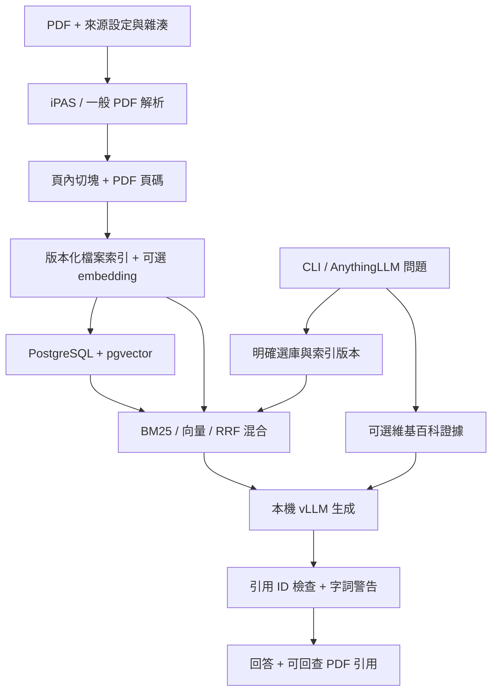

# 系統架構

這是一套以 iPAS 備考起步、可替換文字型 PDF 的本機 RAG。主要工程工作是文件處理、版本化索引、混合檢索、引用檢查與知識庫路由；生成模型及聊天介面使用第三方開源成果。

## 資料與查詢流程

建置時先檢查 PDF 與勘誤雜湊，再保留來源、頁序與切塊設定；向量為可選，未建立向量也能使用 BM25。檔案索引是版本來源，資料庫由驗證過的索引載入；讀回時重新核對完整性。

查詢時 `--kb` 決定知識庫範圍，`index_id` 指定資料版本。多工作區由固定 model 路由到庫及外搜政策；未知 model 拒絕。serve 啟動時載入版本，更新資料後須重啟才會使用新索引。

## 設計取捨

| 決定 | 理由與代價 |
|---|---|
| 保留 BM25 基線，再加向量與 RRF | 專有詞可由關鍵字命中，語意檢索補同義表達；混合增益需評估，不能只靠採用向量庫證明 |
| RRF 各取前 20，常數 60；預設回傳 5 | 不直接相加兩種量尺不同的分數；目前是固定策略，尚未完成跨領域調參驗證 |
| 檔案與 pg 兩種儲存 | 最小檢索不必先裝 DB；pg 提供結構化儲存與向量查詢，BM25／融合仍在 Python |
| 頁內固定視窗 | 簡單且能回查單一 PDF 頁；可能截斷條文／表格，不是版面或圖表理解 |
| 使用 AnythingLLM 作介面 | 重用現成聊天 UI，專注 RAG 管線；其內建 LanceDB 與本專案 pgvector 分離，工作區不需上傳文件 |
| 本機模型、可關外搜 | 可控制資料流與推論環境；需模型快取及足夠硬體，開啟外搜仍會送出搜尋詞 |
| 依據不足／引用錯誤時明確回報 | 降低無依據回答被當成可靠來源的機會；引用 ID、字詞核對與模型逐句核對都不等於事實查核；模型核對每題多一次呼叫 |

## 程式導覽

| 模組 | 職責 |
|---|---|
| [guide.py](../src/ipas_hub/guide.py)、[knowledge.py](../src/ipas_hub/knowledge.py) | 解析、勘誤、切塊、索引、BM25／向量／融合 |
| [pgstore.py](../src/ipas_hub/pgstore.py) | 資料庫載入、完整性驗證與向量查詢 |
| [rag.py](../src/ipas_hub/rag.py)、[prompts](../src/ipas_hub/prompts) | 證據、共用生成契約、引用檢查與輸出 |
| [profile.py](../src/ipas_hub/profile.py) | 把助理角色與領域規則（profile）填入共用契約；範例見 [examples/ipas/profile.json](../examples/ipas/profile.json) |
| [fetch.py](../src/ipas_hub/fetch.py) | 依來源設定的 https 網址下載文件並核對 SHA-256 |
| [demo.py](../src/ipas_hub/demo.py) | 以 iPAS 自寫筆記與替身模型離線重播六種情境 |
| [llm.py](../src/ipas_hub/llm.py)、[websearch.py](../src/ipas_hub/websearch.py) | 模型 API 與外部搜尋 |
| [cli.py](../src/ipas_hub/cli.py)、[server.py](../src/ipas_hub/server.py) | 命令列、OpenAI 相容聊天端點、分庫與 PDF 服務 |
| [tests](../tests) | 合成單元測試、HTTP 路由及可選真實 pg 整合測試 |

## 延伸邊界

替換文字 PDF 只需來源 JSON（`parser: pdf`）與 profile，不需改程式或資料表，步驟見 [換成自己的資料](custom-data.md)。新格式需要 parser；新的外搜提供者需遵守 [WebSearch](../src/ipas_hub/websearch.py) 的回傳契約。改嵌入模型需重建索引，共用路由目前要求模型名稱、revision 與維度一致。

共用契約與 profile 分離後，非 iPAS 領域的回答品質仍需用該領域的題目驗證。端點只處理最後一則使用者問題；SSE 是生成完後傳送完整回答。知識庫路由不是使用者授權；目前僅供本機使用，無多人權限或負載驗收。詳細歷史設計保存在 [內部紀錄](internal/README.md)。
